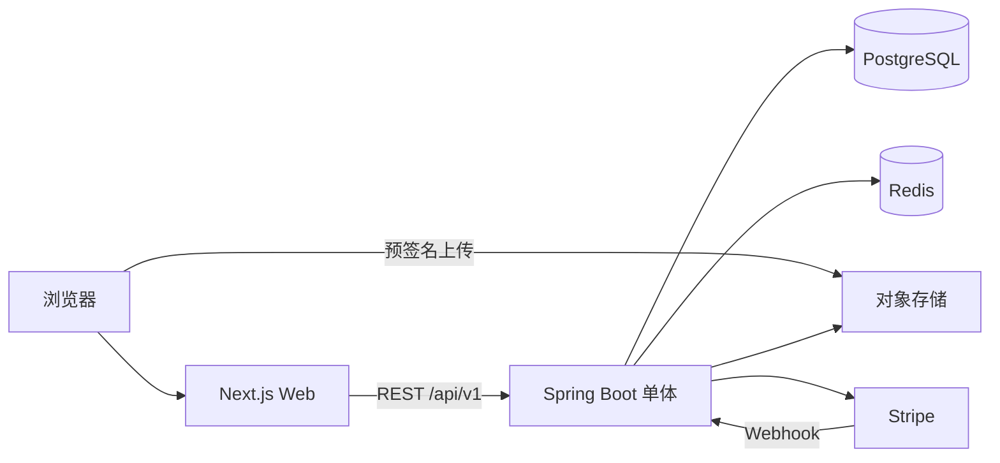
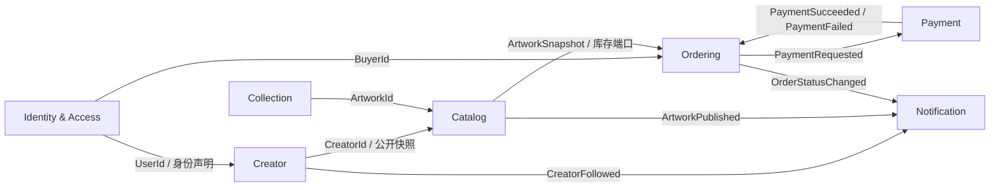
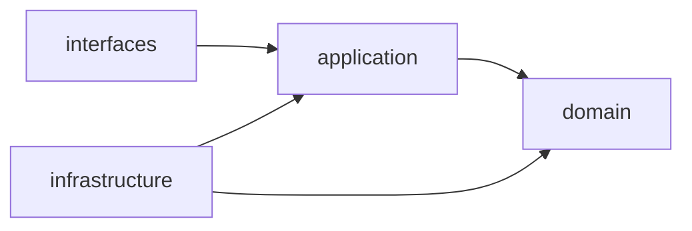
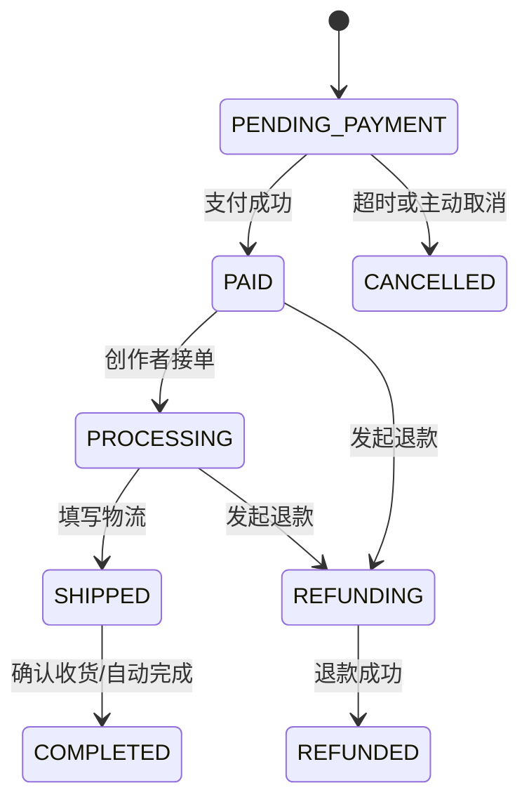
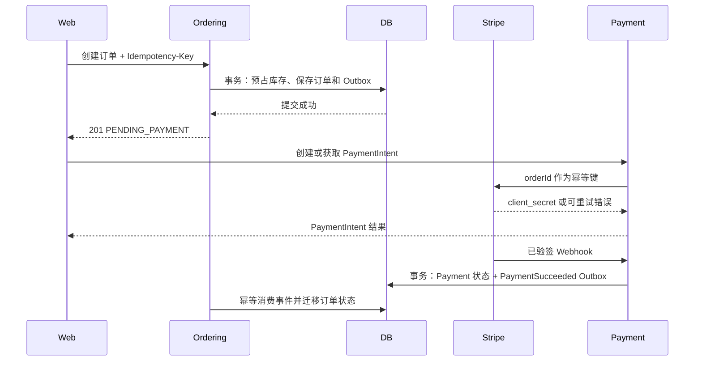
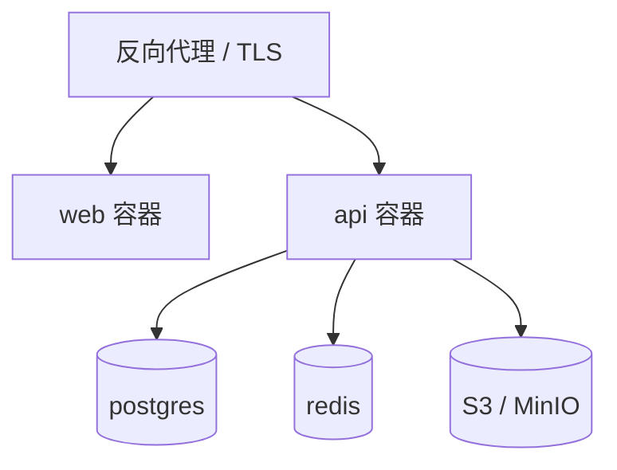

# CreatorHub 开发指南

> 版本：1.0
> 状态：MVP 实施基线
> 产品：独立创作者作品交易社区
> 相关资料：[产品与技术设计](prd_tech_design.md)、[视觉设计系统](figma_design.md)、[OpenAPI 契约](docs/openapi.yaml)、[API 手册](docs/api/README.md)

## 1. 文档目标

本文档是 CreatorHub Web MVP 的工程实施基线，覆盖前端、后端、数据、安全、UI、测试与 Docker 部署。发生冲突时，优先级为：

1. 用户在当前任务中的明确要求与安全红线。
2. `AGENTS.md` 中的仓库协作与技术边界。
3. `docs/openapi.yaml` 中的 HTTP 接口契约。
4. 本文档中的工程约束与已接受 ADR。
5. `prd_tech_design.md` 与 `figma_design.md` 中的产品和视觉建议。
6. `.agent/.skill` 下的通用技能参考。

技能用于补充方法和检查清单，不得覆盖本项目已确定的架构、协议和安全决策。尤其不采用通用技能中的 `Result<T>` 成功响应包装、数字错误码、每端一个 BFF、微服务、Kafka、Event Sourcing、DDD4J 或 Sa-Token，除非用户批准对应 ADR。MyBatis-Plus 仅作为 infrastructure 层数据访问工具。

MVP 目标是验证“发现作品 -> 了解创作者 -> 收藏/关注 -> 下单 -> 支付 -> 创作者履约”的闭环。首版不建设微服务、Kubernetes、Kafka、Elasticsearch和原生 App。

## 2. 技术选型

| 层级 | 技术 | 说明 |
| --- | --- | --- |
| Web | Next.js 15、React 19、TypeScript | App Router、服务端渲染、SEO 与图片优化 |
| UI | Tailwind CSS 4、Radix UI、Lucide | 无障碍基础组件与统一图标 |
| 请求与状态 | TanStack Query、React Hook Form、Zod | 服务端状态、表单与运行时校验 |
| 后端 | Java 21、Spring Boot 3.5 | 单体应用、长期支持版本 JDK |
| 后端组件 | Spring MVC、Security、Validation、MyBatis-Plus | REST、鉴权、校验、显式 SQL 持久化 |
| 数据库 | PostgreSQL 17 | 业务事实数据与事务 |
| 缓存 | Redis 8 | Refresh Token、热点数据、限流与幂等键 |
| 对象存储 | S3 兼容存储；本地 MinIO | 图片直传与静态资源 |
| 数据迁移 | Flyway | 只允许前向、可追踪的 Schema 迁移 |
| 接口契约 | OpenAPI 3.1、springdoc-openapi | 设计优先并校验实现一致性 |
| 测试 | JUnit 5、Testcontainers、Vitest、Playwright | 单元、集成、前端组件与关键路径 E2E |
| 构建部署 | Maven、pnpm、Docker Compose | 可复现构建和单机容器部署 |

不采用 Ant Design。消费者端需要鲜明的品牌视觉，Creator Studio 则使用相同 Token 构建更紧凑的操作界面，避免两套组件体系。

## 3. 系统架构



生产部署包含两个业务容器：`web` 与 `api`。Spring Boot 后端采用 DDD 模块化单体：一个进程、一个代码库、一个数据库，内部按限界上下文隔离。上下文之间只能通过公开的应用端口或领域事件协作，不能跨上下文直接访问 Repository、Mapper、PersistenceRow/DO 或数据表。

### 3.1 仓库建议结构

```text
creatorhub/
├── apps/
│   ├── api/                     # Spring Boot
│   └── web/                     # Next.js
├── docs/
│   ├── openapi.yaml
│   └── adr/                     # 重要架构决策记录
├── infra/
│   ├── compose.yaml
│   └── env.example
├── AGENTS.md
├── CLAUDE.md
└── DEVELOPMENT_GUIDE.md
```

## 4. 后端 DDD 设计

### 4.1 战略设计：限界上下文

建议根包：`com.creatorhub`。包的第一层是限界上下文，而不是技术层。

| 限界上下文 | 类型 | 职责 | 主要聚合 |
| --- | --- | --- | --- |
| Identity & Access | 支撑域 | 注册、认证、会话、角色与用户资料 | User、Session |
| Creator | 核心域 | 创作者身份、主页、认证与关注关系 | Creator、Follow |
| Catalog | 核心域 | 作品内容、媒体、定价、发布和可售库存 | Artwork |
| Collection | 通用域 | 用户收藏作品 | FavoriteCollection |
| Ordering | 核心域 | 价格快照、库存预占、订单与履约状态 | Order |
| Payment | 支撑域 | PaymentIntent、Webhook、退款与支付记录 | Payment |
| Notification | 通用域 | 站内信、邮件和异步通知投递 | Notification |

`Studio` 不是独立领域上下文。它是面向创作者的接口与查询视图，调用 Creator、Catalog、Ordering 的公开应用端口；Dashboard 使用专用只读投影，不拥有交易规则。

统一语言以 [领域术语表](docs/domain/ubiquitous-language.md) 为准。新增业务概念时，必须先确认其所在上下文、中文业务含义、代码名称和禁止混用的近义词，再进入 API、类名和数据库命名。

上下文映射：



映射规则：

- 上下文只共享稳定标识和值快照，不共享聚合对象。
- 同步协作调用对方公开的 application port；调用方不能依赖对方 infrastructure。
- 支付、通知等副作用使用领域事件和 `outbox_events` 可靠投递。
- Stripe、S3 等外部系统通过防腐层转换为领域语言，外部 SDK 类型不得进入 domain。
- `sharedkernel` 仅允许放 `AggregateRoot`、`DomainEvent`、`Money`、强类型 ID 等稳定概念；分页、Web 错误和 Spring 配置不属于 Shared Kernel。
- 领域事件和跨上下文集成事件以 [事件目录](docs/domain/event-catalog.md) 为准；领域事件是上下文内部事实，集成事件是稳定、版本化的跨上下文契约，两者不得直接复用持久化实体或包含敏感信息。

### 4.2 战术设计与包结构

DDD 不是否定 Controller / Service / DAO，而是把它们按限界上下文和依赖方向重新摆位。常见的 Spring 三层（Controller → Service → DAO）在每个限界上下文内继续存在，只是命名和职责被 DDD 严格化：

| 通俗名称 | DDD 角色 | 归属包 | 真实职责 |
| --- | --- | --- | --- |
| Controller | Resource Controller / API Adapter | `interfaces/rest` | HTTP 协议转换、参数校验、授权入口、调用输入端口；不写业务规则 |
| Se├── domain/                    # Money、DomainEvent、基础领域类型
│   └── error/                     # 通用错误码与 Problem Details 基础
├── catalog/
│   ├── domain/
│   │   ├── model/                 # Artwork 聚合、实体、值对象
│   │   ├── service/               # 跨聚合的领域服务
│   │   ├── event/                 # ArtworkPublished 等领域事件
│   │   └── repository/            # ArtworkRepository 端口（“DAO 接口”）
│   ├── application/
│   │   ├── port/in/               # CreateArtworkUseCase 等输入端口
│   │   ├── port/out/              # MediaStorage、跨上下文查询端口
│   │   ├── service/               # ApplicationService = 编排层 Service
│   │   ├── command/               # 命令对象与命令处理器
│   │   └── query/                 # 查询服务与只读 View
│   ├── interfaces/
│   │   ├── rest/                  # Controller、API DTO、DTO Converter
│   │   └── dto/                   # 独立 DTO 包，避免与领域耦合
│   └── infrastructure/
│       ├── persistence/           # PersistenceRow/DO + Mapper + Repository Adapter
│       ├── messaging/             # Outbox 发布适配器
│       ├── storage/               # S3/MinIO 适配器
│       └── search/                # PostgreSQL FTS / pg_trgm 适配器
├── identity/                      # 结构同上
├── creator/                       # 结构同上
├── collection/                    # 结构同上
├── ordering/                      # 结构同上
├── payment/
│   ├── ...
│   ├── interfaces/webhook/        # Stripe Webhook Controller（不走 Bearer）
│   └── infrastructure/stripe/     # Stripe SDK 适配器
├── notification/                  # 结构同上
├── studio/                        # Studio 不是独立上下文，只保留 interfaces + application/query
├── webhook/                       # 通用 Webhook 验签与基础设施
├── outbox/                        # 跨上下文 Outbox 实现
├── config/                        # Spring 配置
└── observability/                 # 日志、指标、健康检查
```

依赖规则：



- `domain` 是纯 Java，不依赖 Spring MVC、MyBatis-Plus、Redis、Stripe 或 S3 SDK。
- `application/service` 编排用例、权限与事务，**不承载应属于聚合的业务规则**；业务规则只写在 `domain/model` 聚合方法或 `domain/service` 中。
- `interfaces/rest` 负责协议转换；Controller 只依赖 `application/port/in`，不直接调用 Repository，不写业务逻辑。
- `infrastructure/persistence` 实现 `domain/repository` 端口；PersistenceRow/DO 与领域模型分离，由 Adapter 显式映射，禁止把 Row/DO 透传到 Controller 或 application service。
- Mapper 与 Mapper XML 只存在于 `infrastructure/persistence`。简单 CRUD 可使用 MyBatis-Plus `BaseMapper`/Wrapper；库存预占、Refresh Token 锁定、报表等关键 SQL 使用显式 XML 并由 PostgreSQL Testcontainers 验证。
- 查询侧可直接生成只读 View/Projection，但不能借此绕过写模型的不变量。
- 使用 ArchUnit 或 Spring Modulith 测试约束：Controller 不能 import Repository、domain 不能 import infrastructure、跨上下文只能 import 对方的 `application/port/in`


- `domain` 是纯 Java，不依赖 Spring MVC、MyBatis-Plus、Redis、Stripe 或 S3 SDK。
- `application` 编排用例、权限与事务，不承载应属于聚合的业务规则。
- `interfaces` 负责协议转换；Controller 只依赖输入端口，不直接调用仓储。
- `infrastructure` 实现仓储和外部端口。PersistenceRow/DO 与领域模型分离，由适配器映射。| Controller（“C”） | `interfaces/rest` | 协议转换、授权入口；不得依赖 Repository 或 Mapper |
| ApplicationService（“S”） | `application/service` | 编排用例与事务；不写业务规则 |
| Repository Adapter（DAO 实现） | `infrastructure/persistence` | 实现 `domain/repository` 端口；返回聚合根，不返回 PersistenceRow/DO |
| PersistenceRow/DO + Mapper | `infrastructure/persistence` | 与领域模型分离，禁止进入 application/interfaces；关键 SQL 使用 XML |- 查询侧可直接生成只读 View/Projection，但不能借此绕过写模型的不变量。
- 使用 ArchUnit 或 Spring Modulith 测试约束上下文边界和依赖方向。

端口归属以本表为准，不直接复制通用技能中的目录或 ArchUnit 矩阵：

| 类型 | 归属 | 说明 |
| --- | --- | --- |
| 输入端口 | `application/port/in` | 对外暴露用例，由 Controller、任务或事件适配器调用 |
| Repository 端口 | `domain/repository` | 以聚合根为单位，使用领域语言 |
| 外部系统端口 | `application/port/out` | S3、Stripe、邮件、时钟等应用编排依赖 |
| 跨上下文同步端口 | 提供方 `application/port/in` | 调用方只依赖提供方公开契约，不依赖其基础设施 |
| 查询模型 | `application/query` | 返回只读 DTO/View，可针对页面查询优化，不修改状态 |

MVP 只采用 L1 CQRS：Command 与 Query 在代码和 DTO 上分离，共享 PostgreSQL，不拆读写数据库，不使用 Event Sourcing。只有量化证明读写负载、模型或扩展需求显著分化后，才通过 ADR 评估 L2。

### 4.3 聚合、值对象与领域规则

| 聚合根 | 所属上下文 | 关键值对象 | 聚合内不变量 |
| --- | --- | --- | --- |
| User | Identity | Email、PasswordHash、UserId | Email 规范化；禁用用户不能创建会话 |
| Creator | Creator | CreatorId、Slug、Profile | 一个 UserId 只能绑定一个 Creator；不能关注自己 |
| Artwork | Catalog | ArtworkId、Money、Stock、MediaSet | 发布前至少一张图片且价格有效；库存不能为负 |
| FavoriteCollection | Collection | UserId、ArtworkId | 同一作品只收藏一次；添加和移除幂等 |
| Order | Ordering | OrderId、OrderLine、Address、Money | 金额使用下单快照；状态只能合法迁移；订单创建后订单项不可变 |
| Payment | Payment | PaymentId、ProviderReference、Money | Provider Event 唯一；支付金额必须匹配订单应付金额 |

建模规则：

- 只能通过聚合根修改聚合内部状态；聚合对外暴露表达业务意图的方法，如 `publish()`、`reserveStock()`、`markPaid()`，不暴露公共 setter。
- 一个事务原则上只修改一个聚合。确需跨聚合一致性时，由应用服务协调，并优先通过领域事件实现最终一致。
- Repository 以聚合根为单位定义在 domain，方法使用领域语言，不为每张表创建 Repository。
- 跨上下文引用只保存强类型 ID 或不可变快照，禁止跨上下文访问 Mapper、PersistenceRow/DO 或数据表。
- 领域服务只处理确实跨多个领域对象且无自然归属的规则；业务用例编排仍属于 application service。
- 聚合在成功完成业务行为后记录过去式领域事件，由应用层在同一事务写入 Outbox。
- 金额使用 `BigDecimal` 封装为 `Money` 值对象并携带 ISO 4217 币种；数据库金额字段使用 `numeric(19,2)`。
- 时间统一存储 UTC `timestamptz`，API 使用 ISO 8601；对外 ID 使用 UUID。
- 业务异常在接口层统一映射为 RFC 9457 Problem Details。
- 列表使用游标分页；后台固定报表可使用页码分页。

订单状态：



### 4.4 库存与支付一致性

下单是风险最高的路径，必须满足：

1. 客户端携带 `Idempotency-Key` 创建订单；相同用户与 Key 返回同一结果。
2. 事务内使用条件更新扣减库存：`stock >= quantity` 才成功。
3. 订单创建为 `PENDING_PAYMENT`，保存价格快照，不信任客户端金额。
4. 订单事务提交后，再以 `orderId` 作为 Stripe 幂等键创建 PaymentIntent；客户端只接收 `client_secret`。
5. 只有验签后的 Stripe Webhook 可以把订单置为 `PAID`。
6. Webhook 事件 ID 建唯一索引，重复投递直接返回 2xx。
7. 未支付订单由定时任务关闭并返还库存；返还操作必须幂等。

Ordering 应用服务协调 Catalog 的库存端口与 Order 聚合。支付结果通过 Payment 上下文发布的领域事件驱动 Order 状态迁移；不得由 Controller 或 Stripe 适配器直接改订单表。

支付时序：



PaymentIntent 创建超时或 5xx 时，订单保持 `PENDING_PAYMENT`，客户端使用相同订单和幂等键重试；不得重复扣库存或新建订单。不可重试的支付配置错误记录稳定错误码并告警，但订单仍可在过期前重新发起支付。只有订单过期任务可以取消订单并幂等返还库存。

MVP 使用数据库事务和 `outbox_events` 表记录跨上下文副作用，由定时 worker 异步处理，不引入消息队列。投递语义为至少一次，事件消费者必须幂等，禁止静默丢弃。

Outbox 最低契约：

- 每条事件包含 `event_id`、`event_type`、`event_version`、`aggregate_type`、`aggregate_id`、`aggregate_version`、`occurred_at`、`payload` 和 `trace_id`。
- 业务数据与 Outbox 必须在同一数据库事务提交；事件载荷不包含密码、Token、完整地址或支付机密。
- Worker 使用 `FOR UPDATE SKIP LOCKED` 或等价机制并发领取，记录 `status`、`attempts`、`next_attempt_at`、`locked_until` 和 `last_error`。
- 使用指数退避加抖动；超过最大次数进入 `DEAD` 并告警，不自动删除。
- 消费者以 `event_id + consumer_name` 去重；状态机守卫作为第二道幂等保护。
- 事件结构只做向后兼容演进；破坏性变更发布新的 `event_version`。
- 已成功事件至少保留 30 天，死信至少保留 90 天；清理任务必须可审计。

### 4.5 搜索与推荐

- MVP 搜索使用 PostgreSQL Full Text Search 和 `pg_trgm`，覆盖作品标题、标签、创作者名。
- 推荐先使用可解释规则：上新、热度、用户关注类别、去重与库存过滤。
- 当搜索量、索引规模或相关性需求超过 PostgreSQL 能力后，再通过 ADR 决定是否引入 OpenSearch。

### 4.6 API 约定

- Base URL：`/api/v1`。
- JSON 属性使用 `camelCase`；枚举使用 `UPPER_SNAKE_CASE`。
- Bearer Access Token 有效期 15 分钟；Refresh Token 有效期 30 天并轮换。
- 创建成功返回 `201` 与 `Location`；删除成功返回 `204`。
- 校验失败返回 `400`，未认证 `401`，无权限 `403`，不存在 `404`，冲突 `409`，限流 `429`。
- 所有请求可携带 `X-Request-Id`；服务端校验 UUID，不存在时生成，并在响应头和 Problem Details 的 `requestId` 中回显同一值。
- 订单创建和 PaymentIntent 要求 `Idempotency-Key`。作用域为“认证用户 + 操作类型 + Key”，保留 24 小时；同 Key、同请求摘要重放原状态码、响应体与 `Location`，同 Key、不同请求摘要返回 `409 IDEMPOTENCY_KEY_REUSED`，并发请求只允许一个执行。
- OpenAPI 是接口单一事实来源。前端类型和客户端从 `docs/openapi.yaml` 生成，不手写重复 DTO。

## 5. 数据库设计

核心表：

```text
users
refresh_tokens
creator_profiles
creator_follows
artworks
artwork_media
artwork_favorites
orders
order_items
payments
payment_webhook_events
shipping_addresses
notifications
outbox_events
```

索引基线：

- `users(lower(email))` 唯一索引。
- `creator_profiles(slug)` 唯一索引。
- `creator_follows(user_id, creator_id)` 唯一索引。
- `artwork_favorites(user_id, artwork_id)` 唯一索引。
- `artworks(status, published_at desc)` Feed 索引。
- `orders(buyer_id, created_at desc)` 与 `orders(seller_id, created_at desc)`。
- `payment_webhook_events(provider_event_id)` 唯一索引。

Flyway 文件命名为 `V{yyyyMMddHHmm}__{description}.sql`。已进入共享环境的 migration 禁止修改，只能增加新 migration。

## 6. 前端设计

### 6.1 应用结构

```text
apps/web/src/
├── app/
│   ├── (market)/                 # 首页、发现、作品、创作者
│   ├── (checkout)/               # 结算与支付结果
│   ├── studio/                   # Creator Studio
│   └── api/                      # 必要的 BFF/认证回调
├── components/
│   ├── ui/                       # 无业务基础组件
│   └── domain/                   # ArtworkCard、CreatorCard 等
├── features/                     # auth、artwork、order、studio
├── lib/                          # API client、格式化、配置
└── styles/
```

### 6.2 渲染与状态策略

- 首页、分类、作品详情和创作者主页优先 Server Components，保证 SEO 和首屏性能。
- 收藏、关注、购物与 Studio 表单使用 Client Components。
- TanStack Query 只管理远程服务端状态；短暂 UI 状态留在组件本地。
- URL 保存可分享状态，例如搜索词、分类、排序和筛选条件。
- 图片使用 `next/image`，上传前校验 MIME、大小和尺寸并展示进度。
- API 错误统一解析 Problem Details，不在页面中散落状态码判断。

### 6.3 页面范围

消费者端 MVP：

- 首页 Discover：特色创作者、最新作品、分类、即将开放的 Drop 预告。
- Marketplace：搜索、分类、价格、状态筛选与游标加载。
- Artwork Detail：画廊、故事、版本/库存、创作者、购买与收藏。
- Creator Profile：封面、简介、关注、作品与 About。
- Checkout：地址、订单摘要、Stripe Payment Element、结果页。
- Account：资料、收藏、关注、购买订单。

Creator Studio MVP：

- Dashboard：收入、订单、作品、转化概览。
- Works：列表、新建、编辑、发布、下架。
- Orders：筛选、详情、接单、录入物流。
- Settings：创作者资料与收款状态。

## 7. 视觉 UI 与交互

方向：编辑画廊的克制感、真实创作者的温度、交易平台的可信度。作品和创作者是首屏信号，不使用营销式大卡片堆叠、装饰性光球或单一紫色主题。

### 7.1 Design Tokens

```css
:root {
  --color-ink: #111111;
  --color-text: #1a1a1a;
  --color-muted: #6f6f6b;
  --color-border: #d8d8d3;
  --color-canvas: #fafaf8;
  --color-surface: #ffffff;
  --color-accent: #c97b4b;
  --color-success: #2e7d5b;
  --color-danger: #d64545;
  --color-warning: #d89b32;
  --radius-control: 8px;
  --radius-media: 6px;
  --shadow-overlay: 0 8px 24px rgb(0 0 0 / 12%);
}
```

- 展示字体：`Newsreader`，用于首页与作品标题；UI 字体：`Manrope`；中文回退 `PingFang SC`、`Noto Sans SC`。
- 作品卡图片固定 `4 / 5`，Creator Cover 固定 `16 / 9`，避免加载后布局跳动。
- 卡片圆角不超过 8px，不嵌套卡片；页面 Section 使用无边框的全宽内容带。
- 主按钮黑底白字，强调色只用于收藏、Drop、限量状态和少量焦点。
- 图标统一 Lucide 2px stroke；仅图标按钮必须有可访问名称和 Tooltip。
- 动效时长 160-240ms，只用于画廊进入、收藏反馈和视图切换；尊重 `prefers-reduced-motion`。

### 7.2 响应式与无障碍

| 断点 | 布局 |
| --- | --- |
| `< 640px` | 双列作品流、底部导航、结算单列 |
| `640-1023px` | 三列作品流、压缩页边距 |
| `>= 1024px` | 四列作品流、顶部导航、Studio 侧边栏 |
| `>= 1440px` | 内容最大宽度 1440px，增加留白而非无限放大字体 |

- 遵循 WCAG 2.2 AA；正文对比度至少 4.5:1。
- 全流程可键盘操作；焦点样式不可移除。
- 表单错误与字段关联，异步状态通过 `aria-live` 宣告。
- 触控目标至少 44 x 44px。
- Skeleton 尺寸必须等于最终内容尺寸，禁止传统全页 spinner。

## 8. 安全与隐私

- 密码使用 Argon2id；登录、注册、重置密码和 Webhook 分别限流。
- Refresh Token 仅放入 `HttpOnly + Secure + SameSite=Lax` Cookie；Access Token 不写入 localStorage。
- Refresh Cookie 固定 `Path=/api/v1/auth`，生产环境启用 `Secure`，不设置 `Domain`；登录和刷新时轮换，注销时使用相同属性和 `Max-Age=0` 清除。
- 使用 Cookie 的刷新与注销接口执行 Origin/Referer 校验；若未来改为 `SameSite=None` 或开放跨站客户端，必须增加显式 CSRF Token 防护。
- Spring Security 默认拒绝，按角色 `USER`、`CREATOR`、`ADMIN` 明确放行。
- 所有资源执行对象级权限检查，不能只依赖前端隐藏按钮。
- 上传使用短期预签名 URL，限制 Content-Type、文件大小和对象 key 前缀。
- Stripe Webhook 使用原始请求体验签；密钥只通过环境变量或 Secret 注入。
- 日志不记录密码、Token、Cookie、支付信息、完整地址和邮箱。
- 用户输入默认纯文本；支持富文本时使用白名单 sanitizer。

## 9. 测试策略

| 类型 | 范围 | 门槛 |
| --- | --- | --- |
| 后端单元测试 | 价格、库存、订单状态、权限规则 | 核心领域分支完整覆盖 |
| 后端集成测试 | PostgreSQL、Redis、Security、Webhook | 使用 Testcontainers，不用 H2 替代 PostgreSQL |
| 前端组件测试 | 表单、错误态、交互态 | Vitest + jsdom + Testing Library，按用户行为断言 |
| 契约测试 | OpenAPI 请求/响应 | CI 校验规范并检测破坏性变更 |
| E2E | 注册、浏览、收藏、下单、履约 | Playwright 覆盖成功与关键失败路径 |
| 视觉检查 | 首页、详情、Studio | 375、768、1440 三种视口，无溢出或遮挡 |

PR 最低检查：后端格式化与测试、前端 lint/typecheck/test、OpenAPI lint、Docker 镜像构建。

后端领域测试不启动 Spring、不 Mock 聚合，并直接验证不变量和领域事件。Repository、Flyway、Security、Webhook 与 Outbox 使用真实 PostgreSQL/Redis Testcontainers；架构测试使用 ArchUnit。Playwright 优先角色和可访问名称定位器，CI 失败时保留 trace、截图和视频。

## 10. Docker 部署

### 10.1 容器拓扑



- `api` 使用多阶段构建：Maven 3.9 + JDK 21 builder -> JRE 21 runtime。
- `web` 使用 Next.js `output: standalone` 多阶段构建。
- 数据库、Redis 仅暴露在 Compose 内网；只有反向代理开放 80/443。
- 容器使用非 root 用户、只读根文件系统（临时目录除外）、健康检查和资源上限。
- PostgreSQL 与对象存储使用持久卷；上线前必须验证备份恢复。
- Schema migration 作为一次性部署任务执行，成功后再滚动应用。

建议环境：`local`、`test`、`staging`、`production`。必须配置：

```text
DATABASE_URL
REDIS_URL
JWT_PRIVATE_KEY
JWT_PUBLIC_KEY
S3_ENDPOINT
S3_BUCKET
S3_ACCESS_KEY
S3_SECRET_KEY
STRIPE_SECRET_KEY
STRIPE_WEBHOOK_SECRET
APP_BASE_URL
```

仓库仅提交 `.env.example`，绝不提交真实密钥。

## 11. 可观测性

- Spring Boot Actuator 提供存活、就绪、指标端点；敏感端点不对公网开放。
- 日志输出结构化 JSON，包含 `timestamp`、`level`、`service`、`requestId`、`userId`（可空）与错误码。
- Micrometer 记录 HTTP 延迟、错误率、数据库池、订单创建、支付成功和库存冲突。
- Sentry 或 OpenTelemetry 收集前后端异常；不得在事件中发送敏感数据。
- 首版告警至少覆盖：5xx 激增、支付 Webhook 失败、数据库连接耗尽、磁盘/卷容量不足。

## 12. 开发流程与里程碑

### Phase 0：工程基座（1 周）

- 初始化 Maven、Next.js、Compose、CI、Flyway、OpenAPI 校验。
- 完成 Design Token、基础布局、认证骨架与错误模型。

### Phase 1：发现与内容（2-3 周）

- 创作者资料、作品 CRUD、图片直传、首页、搜索、详情页。

### Phase 2：关系与交易（3-4 周）

- 关注、收藏、地址、库存、订单、Stripe 支付与 Webhook。

### Phase 3：Creator Studio（2-3 周）

- 作品管理、订单履约、Dashboard 与设置。

### Phase 4：上线准备（1-2 周）

- E2E、安全检查、性能预算、备份恢复、监控告警和灰度发布。

完成定义：需求验收通过、OpenAPI 已同步、关键测试通过、无高危漏洞、日志与指标可定位问题、移动端与桌面端均完成视觉检查。

## 13. 明确不做

MVP 暂不实现：微服务、Kubernetes、消息队列、原生移动端、评论、二手交易、复杂推荐模型、多币种结算、多卖家购物车和自建搜索集群。新增这些能力必须先提交 ADR，说明用户价值、维护成本和迁移方案。