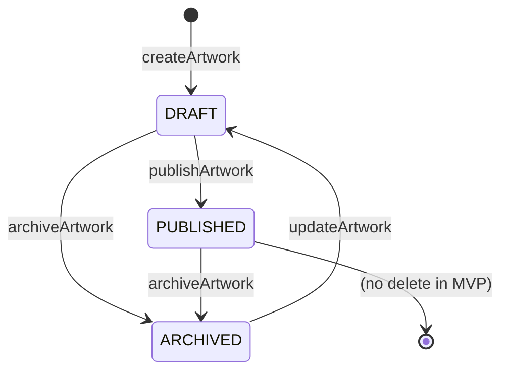
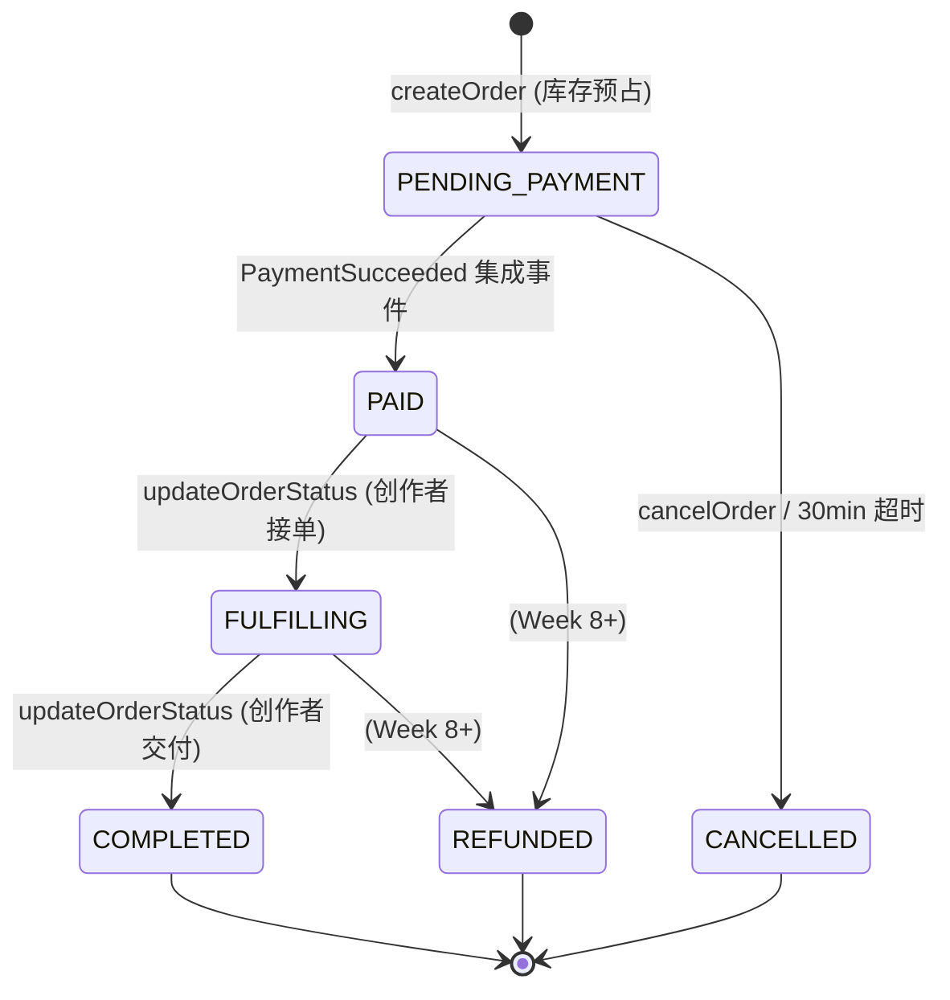
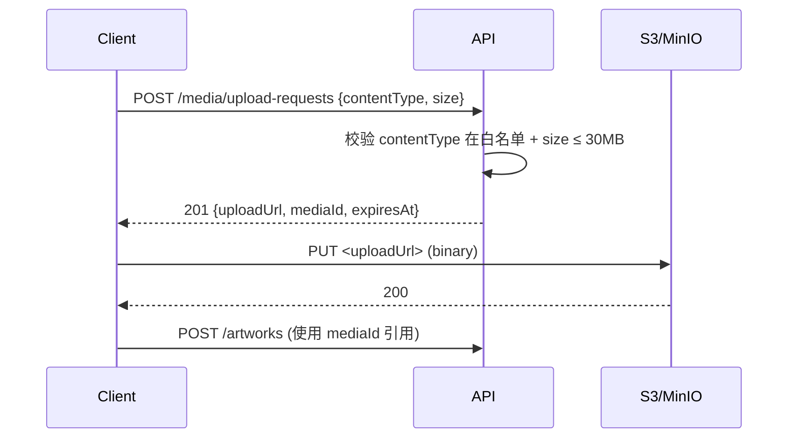
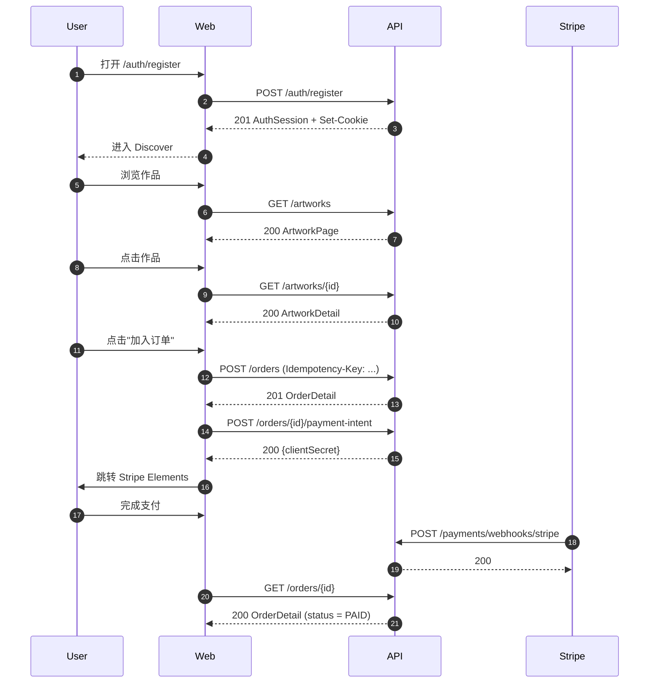
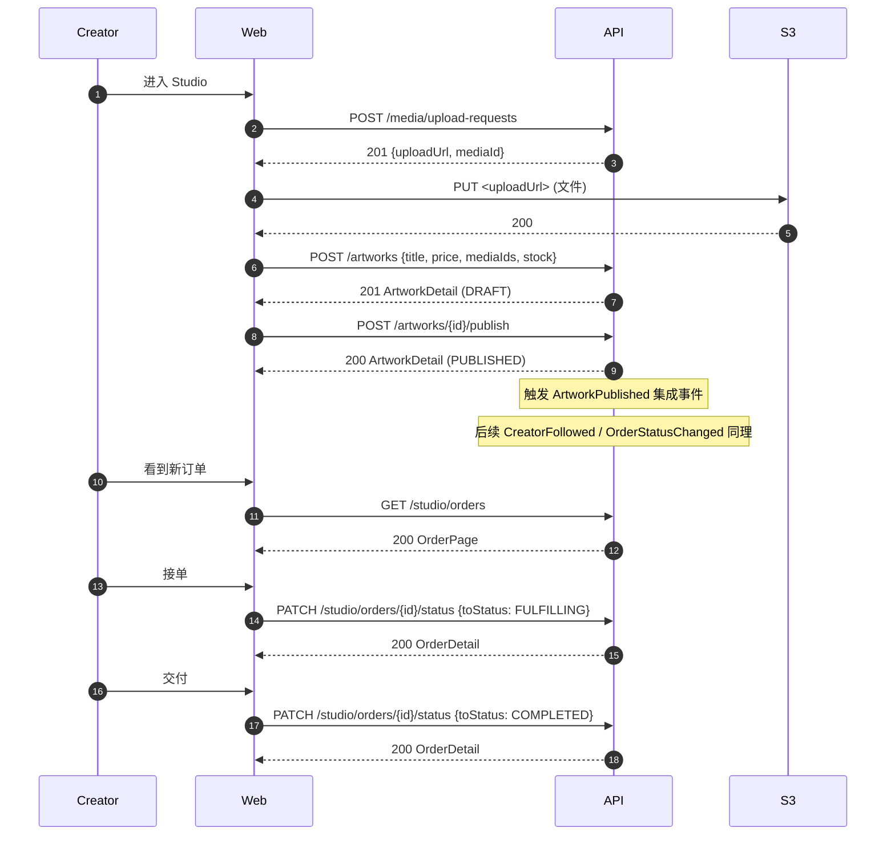
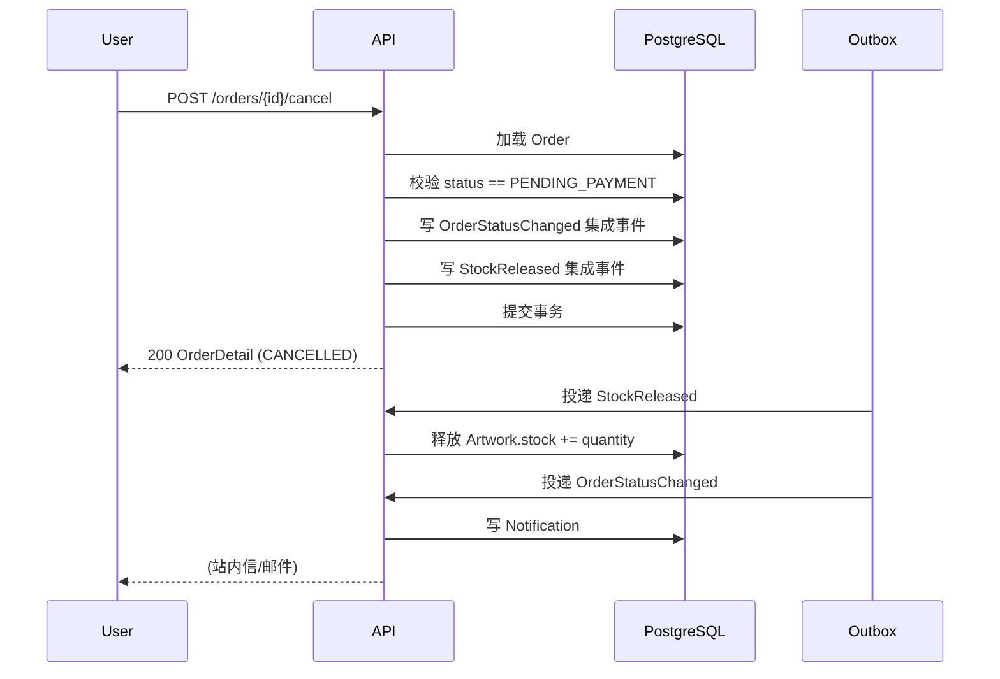

# CreatorHub API 手册

> 状态：与 [`docs/openapi.yaml`](../openapi.yaml) 同步（v1.0.0）。
> 范围：覆盖 MVP 14 周计划中**已规划**的 26 个端点 / 36 个 operation。
> 目标读者：前端工程师、第三方对接方、QA、Code Reviewer。

本文档是 [`docs/openapi.yaml`](../openapi.yaml) 的**工程级导读**。`openapi.yaml` 是机器可读的单一事实来源（Single Source of Truth）；本文档回答"为什么这样设计"、"怎么用"和"哪些是 Week 3 才能用的"，并按限界上下文而非 URL 路径重新组织。

发生冲突时以 `openapi.yaml` 为准；本文档的变更必须先改 `openapi.yaml`、再同步本文件。

---

## 1. 阅读路径

| 你是谁 | 先读 |
| --- | --- |
| 前端工程师 | §3 通用约定 → §5 端点速查（按上下文）→ §6 关键工作流 → §7 错误码表 |
| 后端工程师 | §3 通用约定 → §4 限流与幂等 → §6 关键工作流 → §8 OpenAPI 校验 |
| 第三方对接 | §3 通用约定 → §5.1 鉴权上下文 → §5.8 Payment Webhook |
| QA | §3 通用约定 → §6 关键工作流 → §7 错误码表 |

---

## 2. 仓库内位置

```text
docs/
├── openapi.yaml            # 机器可读契约（Single Source of Truth）
├── api/
│   └── README.md           # 本文件
├── domain/
│   ├── ubiquitous-language.md   # 业务术语与代码命名
│   └── event-catalog.md         # 领域事件与集成事件目录
```

`openapi.yaml` 位于仓库根的 `docs/` 下，是**前后端联调的契约入口**。任何端点变更必须先改它再写代码（contract-first）。

---

## 3. 通用约定

### 3.1 基础地址与版本

| 环境 | Base URL |
| --- | --- |
| 本地 | `http://localhost:8080/api/v1` |
| Staging | `https://api.staging.creatorhub.example/api/v1` |
| 生产 | 见部署文档（未在 `openapi.yaml` 列出，避免文档漂移） |

所有业务端点都以 `/api/v1` 为前缀。`/actuator/*`、 `/v3/api-docs`、 `/swagger-ui.html` 不带前缀，仅服务观测与文档。

### 3.2 内容类型

- 入参：`application/json; charset=utf-8`
- 出参：`application/json; charset=utf-8`，字段顺序不保证
- 文件上传：使用 `multipart/form-data` 走对象存储预签名 URL（见 §5.6），**不**直传后端

### 3.3 时间与币种

- **时间**：ISO 8601 UTC（`2026-08-25T12:34:56.789Z`），无时区缩写
- **金额**：`Money` schema = decimal 字符串 + ISO 4217 币种（`"188.00"` + `"CNY"`）
- **ID**：所有公开 ID 均为 UUID 字符串，**禁止**用自增整数
- **JSON 字段命名**：camelCase，遵循 Spring Boot / Jackson 默认

### 3.4 鉴权（两种凭证）

| 凭证 | 用途 | 传递方式 |
| --- | --- | --- |
| Access Token | 受保护资源访问 | `Authorization: Bearer <jwt>` |
| Refresh Token | 轮换 Access Token | HttpOnly Cookie `refresh_token`（浏览器自动） |

Cookie 属性固定为 `HttpOnly; Secure; SameSite=Lax; Path=/api/v1/auth; Max-Age=2592000`，**不**设置 `Domain` 以避免子域串扰。

Webhook 端点（`/payments/webhooks/stripe`）**不走** Bearer 也不走 Cookie，使用 Stripe 签名头验签。

### 3.5 Request ID

- 客户端通过 `X-Request-Id: <uuid>` 注入；缺失时服务端生成
- 服务端在响应头 `X-Request-Id` 回显
- 同一 Request ID 出现在 Problem Details 的 `requestId` 字段与日志中
- 用于跨服务链路追踪与用户报障时的工单关联

### 3.6 错误响应：RFC 9457 Problem Details

错误响应**统一**使用 Problem Details，**不**返回 `Result<T>` 包装。Body 是 `application/problem+json`，含稳定字段：

| 字段 | 类型 | 含义 |
| --- | --- | --- |
| `type` | URI | 错误类型，URL 可解析到错误说明页（`https://creatorhub.com/problems/<code>`） |
| `title` | string | 人类可读的错误名 |
| `status` | int | HTTP 状态码 |
| `detail` | string | 人类可读的错误详情 |
| `instance` | URI | 出错请求的 URI |
| `code` | string | 稳定业务错误码（前端按此路由） |
| `requestId` | UUID | 与响应头 `X-Request-Id` 一致 |
| `fieldErrors` | object | 校验错误时附加（字段名 → 错误消息） |
| `details` | object | 业务错误附加上下文（如 `orderId`、`paymentId`） |

错误码见 §7。

### 3.7 限流

登录、注册、刷新三个端点启用 Redis 滑动窗口限流：
- 同一 IP 登录：5 次 / 分钟
- 同一邮箱登录：10 次 / 小时
- 同一 IP 注册：3 次 / 小时
- 同一 IP 刷新：30 次 / 分钟

超限返回 `429 Too Many Requests`，Problem Details `code = "RATE_LIMITED"`。

### 3.8 分页

公开查询端点统一使用**游标分页**（基于 `createdAt + id` 复合游标），不返回 `total`：

```http
GET /artworks?cursor=eyJjcmVhdGVkQXQiOiIyMDI2LTA4LTI1VDA4OjAwIn0&limit=20
```

响应：

```json
{
  "items": [ ... ],
  "nextCursor": "eyJjcmVhdGVkQXQiOiIyMDI2LTA4LTI1VDA3OjAwIn0",
  "hasMore": true
}
```

`limit` 上限 100，默认 20。详情见 §5。

### 3.9 幂等

写操作使用客户端生成的 `Idempotency-Key` 头（UUID 字符串）。服务端用 Redis 缓存响应 24 小时。重复请求返回**首次响应**，**不**重复执行副作用。

需要幂等的写操作：
- 创建订单（`POST /orders`）
- 取消订单（`POST /orders/{orderId}/cancel`）
- 标记通知已读（除 `DELETE` 风格的 `PATCH`）

WebHook（Stripe）使用 `event.id` 作为幂等键，不依赖 `Idempotency-Key`。

---

## 4. 鉴权与会话

### 4.1 凭证生命周期

```mermaid
sequenceDiagram
    participant B as Browser
    participant A as API
    participant R as Redis
    B->>A: POST /auth/login {email, password}
    A->>R: 验证 email+password
    A-->>B: 200 AuthSession + Set-Cookie refresh_token
    Note over B,A: 后续 15 分钟内
    B->>A: GET /me  Authorization: Bearer <access>
    A-->>B: 200 UserSummary
    Note over B,A: 15 分钟后
    B->>A: POST /auth/refresh  Cookie: refresh_token=...
    A->>R: 验证 refresh token
    A-->>B: 200 AuthSession + Set-Cookie refresh_token（轮换）
    B->>A: POST /auth/logout
    A->>R: 撤销 refresh token
    A-->>B: 204 + Set-Cookie refresh_token=; Max-Age=0
```

- **Access Token** TTL 15 分钟；过期签发 401，前端应**静默**调用 `/auth/refresh` 后重试原请求
- **Refresh Token** TTL 30 天；轮换时**新 token 立即作废旧 token**（reuse detection）
- **登出** 立即撤销 Refresh Token；Access Token 仍可能活到 TTL 结束（接受此窗口，因为短）

### 4.2 角色

| 角色 | 描述 | 鉴权来源 |
| --- | --- | --- |
| `ROLE_BUYER` | 默认注册即获得 | Access Token claim |
| `ROLE_CREATOR` | 通过 `POST /me/creator` 申请 | Access Token claim + Creator 聚合存在 |
| `ROLE_STAFF` | 内部运营 | 不在 MVP 范围 |

某些端点根据资源 owner 做对象级权限校验（不是角色）。如 `PUT /studio/artworks/{id}` 要求 Access Token 的 `userId` 等于 Artwork 的 `creator.userId`；不通过返回 `403 FORBIDDEN`。

### 4.3 Webhook 鉴权

`POST /payments/webhooks/stripe`：

- 不需要 Bearer / Cookie
- 验证 `Stripe-Signature` 头，验签失败返回 `401 UNAUTHORIZED` 且**不**记录原始 payload（防止日志泄漏）
- 验签通过后**幂等**地按 `event.id` 处理：先查 `payment_events` 表是否已处理，已处理返回 200 跳过

---

## 5. 端点速查（按限界上下文）

> Week 3 已实现 Identity 注册/登录/刷新/注销/当前用户与 Creator 申请/更新/公开详情。
> 其余端点仍是 MVP 全量设计，按表内里程碑逐步落地。
>
> 路径前缀 `/api/v1` 全部省略；服务器列表见 §3.1。

### 5.1 Identity & Access（Week 3）

负责注册、登录、会话、当前用户查询。

| Method | Path | Operation | 鉴权 | 备注 |
| --- | --- | --- | --- | --- |
| `GET` | `/health` | `getHealth` | 无 | Actuator `/actuator/health` 的语义化版本；前端启动时可调用 |
| `POST` | `/auth/register` | `register` | 无 | 邮箱+密码注册；返回 Access Token 与 Set-Cookie；201 |
| `POST` | `/auth/login` | `login` | 无 | 邮箱+密码登录；200 |
| `POST` | `/auth/refresh` | `refreshSession` | Refresh Cookie | 轮换 Refresh Token；200 |
| `POST` | `/auth/logout` | `logout` | Bearer + Refresh Cookie | 撤销当前 Refresh Token；204 |
| `GET` | `/me` | `getCurrentUser` | Bearer | 当前用户概要；用于 Navbar 头像、Studio 入口显示 |

**关键 DTO**：`AuthSession { accessToken, accessTokenExpiresAt, user }`、`UserSummary { id, displayName, avatarUrl, roles }`。

错误码：`EMAIL_TAKEN`（409）、`INVALID_CREDENTIALS`（401）、`REFRESH_TOKEN_INVALID`（401）、`RATE_LIMITED`（429）。

### 5.2 Creator（Week 3-4）

负责创作者身份、公开主页、关注关系。

| Method | Path | Operation | 鉴权 | 备注 |
| --- | --- | --- | --- | --- |
| `POST` | `/me/creator` | `applyForCreator` | Bearer | 申请成为 Creator；幂等，重复申请返回现有 Creator（200） |
| `PUT` | `/me/creator` | `updateMyCreatorProfile` | Bearer + ROLE_CREATOR | 部分更新；200 |
| `GET` | `/creators` | `listCreators` | 无 | 公开列表，游标分页 |
| `GET` | `/creators/{creatorId}` | `getCreator` | 无 | 公开主页；含 `isFollowedByMe`（需 Bearer） |
| `PUT` | `/creators/{creatorId}/follow` | `followCreator` | Bearer | 关注；幂等，重复返回当前状态 |
| `DELETE` | `/creators/{creatorId}/follow` | `unfollowCreator` | Bearer | 取消关注；幂等 |
| `GET` | `/creators/{creatorId}/followers` | `listFollowers` | 无 | 公开粉丝列表；游标分页 |

**关键 DTO**：`CreatorSummary`、`CreatorDetail`、`FollowState { creatorId, isFollowed, followerCount }`。

关注变更触发 `CreatorFollowed` / `CreatorUnfollowed` 集成事件（见 `event-catalog.md`）。

### 5.3 Catalog（Week 4-5）

负责作品内容、媒体、定价、发布与可售库存。**不**处理订单与支付。

| Method | Path | Operation | 鉴权 | 备注 |
| --- | --- | --- | --- | --- |
| `GET` | `/artworks` | `listArtworks` | 无 | 公开列表；支持 `category`、`q`、`creatorId`、`minPrice`、`maxPrice` 过滤；游标分页 |
| `GET` | `/artworks/{artworkId}` | `getArtwork` | 无 | 公开详情；含 `stock`（可售库存） |
| `POST` | `/artworks` | `createArtwork` | Bearer + ROLE_CREATOR | 创建草稿（`status = DRAFT`） |
| `PUT` | `/artworks/{artworkId}` | `updateArtwork` | Bearer + Creator Owner | 仅 `DRAFT` / `ARCHIVED` 可改；`PUBLISHED` 需先 `archive` |
| `POST` | `/artworks/{artworkId}/publish` | `publishArtwork` | Bearer + Creator Owner | 草稿上架；要求至少 1 张媒体 + 有效价格 + 库存 > 0 |
| `POST` | `/artworks/{artworkId}/archive` | `archiveArtwork` | Bearer + Creator Owner | 下架；保留作品页但不可购买 |
| `GET` | `/studio/artworks` | `listMyArtworks` | Bearer + ROLE_CREATOR | 创作者后台作品列表；含 `DRAFT` / `PUBLISHED` / `ARCHIVED` |
| `PATCH` | `/studio/artworks/{artworkId}/status` | `updateArtworkStatus` | Bearer + Creator Owner | 批量状态变更；用于 Studio 多选操作 |

**关键 DTO**：`ArtworkSummary`、`ArtworkDetail`、`ArtworkWriteRequest`、`ArtworkPage`。

**价格**：使用 `Money { amount, currency }`，decimal 字符串。最低价格 `0.01`（不允许 0 元上架以防滥用）。

**状态机**：



状态迁移通过聚合方法实现，不暴露通用 `setStatus`。Studio 的批量操作在 application service 内部逐个调用聚合方法。

发布触发 `ArtworkPublished` 集成事件。下架触发 `ArtworkArchived`。

### 5.4 Collection（Week 5）

用户收藏作品。

| Method | Path | Operation | 鉴权 | 备注 |
| --- | --- | --- | --- | --- |
| `PUT` | `/favorites/{artworkId}` | `addFavorite` | Bearer | 幂等 |
| `DELETE` | `/favorites/{artworkId}` | `removeFavorite` | Bearer | 幂等 |
| `GET` | `/favorites/{artworkId}` | `getFavoriteState` | Bearer | 单作品收藏状态；用于详情页心形按钮 |
| `GET` | `/me/favorites` | `listMyFavorites` | Bearer | 收藏列表；游标分页；可按 `collectionName` 过滤 |

**关键 DTO**：`FavoriteState { artworkId, isFavorited, favoritedAt, collections: string[] }`。

MVP 不支持多收藏夹分组，仅 `collections: ["default"]` 占位。Week 5 后迭代。

### 5.5 Ordering（Week 6-7）

订单生命周期：待支付 → 已支付 → 履约中 → 完成 / 取消 / 退款。

| Method | Path | Operation | 鉴权 | 备注 |
| --- | --- | --- | --- | --- |
| `POST` | `/orders` | `createOrder` | Bearer + Idempotency-Key | 同一 Buyer 在同一 Creator 的多件作品合成一单；201 |
| `GET` | `/orders/{orderId}` | `getOrder` | Bearer + Order Owner | 订单详情；含 `items[]`、`shippingAddress`、`statusHistory` |
| `POST` | `/orders/{orderId}/cancel` | `cancelOrder` | Bearer + Order Owner | 仅 `PENDING_PAYMENT` 可取消；幂等；释放库存 |
| `POST` | `/orders/{orderId}/payment-intent` | `createPaymentIntent` | Bearer + Order Owner | 为订单创建 Stripe PaymentIntent；返回 clientSecret |
| `GET` | `/studio/orders` | `listStudioOrders` | Bearer + ROLE_CREATOR | 创作者后台订单列表；按状态过滤 |
| `PATCH` | `/studio/orders/{orderId}/status` | `updateOrderStatus` | Bearer + Creator Owner | 创作者推进履约状态 |

**状态机**：



**关键不变量**（在领域内强制，不允许绕过）：

- 同一订单的所有作品必须属于同一 Creator（避免跨创作者合单导致履约责任不清）
- 价格在 `createOrder` 时**冻结**为 `ArtworkSnapshot`，后续作品价格变更不影响已存在订单
- 库存预占与订单在同一事务；取消或支付失败时通过 `StockReleased` 集成事件释放
- 状态迁移通过聚合方法 `markPaid`、`markFulfilling`、`markCompleted` 等实现；`updateOrderStatus` Controller 按 `toStatus` 分发到对应方法

### 5.6 Media（Week 4）

媒体文件上传走**预签名 URL**，后端不接收文件流。

| Method | Path | Operation | 鉴权 | 备注 |
| --- | --- | --- | --- | --- |
| `POST` | `/media/upload-requests` | `requestUpload` | Bearer + ROLE_CREATOR | 返回 S3 预签名 PUT URL + 资源 ID；客户端直传 S3 |

**流程**：



直传完成后**必须**在 `POST /artworks` 或 `PUT /artworks/{id}` 中通过 `mediaId[]` 引用，否则 24 小时后被 S3 生命周期策略清理。

### 5.7 Payment（Week 7）

| Method | Path | Operation | 鉴权 | 备注 |
| --- | --- | --- | --- | --- |
| `POST` | `/payments/webhooks/stripe` | `stripeWebhook` | Stripe 签名 | Stripe 主动推送；不返回业务数据，仅 200/4xx |

Webhook 验签失败返回 `401` 且不记录 payload 内容。验签成功后按 `event.id` 幂等处理。

通过 Webhook 推动的状态变更**不**通过前端轮询；前端监听订单详情页的 SSE（Week 7 之后）或刷新订单时拿到最新状态。

### 5.8 Studio（Week 4-7）

创作者后台视图，**不是独立领域上下文**，仅是 Creator + Catalog + Ordering 的只读查询与状态变更入口。所有写操作都落到对应聚合的 application service。

| Method | Path | Operation | 鉴权 | 备注 |
| --- | --- | --- | --- | --- |
| `GET` | `/studio/dashboard` | `getStudioDashboard` | Bearer + ROLE_CREATOR | 概览数据：作品数、待处理订单数、本周营收 |
| `GET` | `/studio/artworks` | `listMyArtworks` | Bearer + ROLE_CREATOR | 同 §5.3 |
| `GET` | `/studio/orders` | `listStudioOrders` | Bearer + ROLE_CREATOR | 同 §5.5 |
| `PATCH` | `/studio/artworks/{artworkId}/status` | `updateArtworkStatus` | Bearer + Creator Owner | 同 §5.3 |
| `PATCH` | `/studio/orders/{orderId}/status` | `updateOrderStatus` | Bearer + Creator Owner | 同 §5.5 |

Dashboard 数据通过 CQRS L1（共享数据库的代码级读写分离）从 Catalog/Ordering 的只读视图拼装，不持有交易规则。

### 5.9 Notification（Week 8+）

| Method | Path | Operation | 鉴权 | 备注 |
| --- | --- | --- | --- | --- |
| `GET` | `/notifications` | `listNotifications` | Bearer | 当前用户通知列表；未读数 |
| `POST` | `/notifications/{notificationId}/read` | `markNotificationRead` | Bearer | 幂等 |

通知数据来自跨上下文集成事件（`CreatorFollowed`、`ArtworkPublished`、`OrderStatusChanged` 等）。通知不替代邮件/推送，仅作站内信；Week 8 之后迭代。

---

## 6. 关键工作流

### 6.1 注册到下单（消费者视角）



### 6.2 创作者上架到履约



### 6.3 取消订单与库存释放



Outbox 投递失败重试 5 次；超过 5 次进入死信队列，由人工干预。

---

## 7. 错误码表

> 稳定业务错误码，定义在 `sharedkernel/error/BusinessError`。所有错误都映射为 RFC 9457 Problem Details。

### 7.1 通用（4xx / 5xx）

| code | status | 含义 | 何时出现 |
| --- | --- | --- | --- |
| `VALIDATION_FAILED` | 400 | 请求体验证失败 | `@Valid` 校验、缺失字段、类型错误；`fieldErrors` 含字段详情 |
| `UNAUTHORIZED` | 401 | 缺少或无效凭证 | 无 Bearer、Token 过期或被撤销 |
| `FORBIDDEN` | 403 | 凭证有效但无权限 | 角色不足、不是资源 owner |
| `NOT_FOUND` | 404 | 资源不存在 | 端点存在但 ID 无效 |
| `CONFLICT` | 409 | 资源状态冲突 | 唯一约束冲突（如 `EMAIL_TAKEN`） |
| `GONE` | 410 | 资源已不可用 | 撤销的资源、被归档的作品访问受限字段 |
| `RATE_LIMITED` | 429 | 超出速率限制 | 登录/注册/刷新超限；含 `retryAfterSeconds` |
| `INTERNAL_ERROR` | 500 | 服务端未捕获错误 | 兜底；前端应只展示通用文案，不依赖 detail |

### 7.2 业务（按上下文）

| code | 上下文 | 含义 |
| --- | --- | --- |
| `EMAIL_TAKEN` | Identity | 邮箱已注册 |
| `INVALID_CREDENTIALS` | Identity | 邮箱或密码错误 |
| `REFRESH_TOKEN_INVALID` | Identity | Refresh Token 无效、过期或被撤销 |
| `CREATOR_ALREADY_EXISTS` | Creator | 已申请过 Creator |
| `CREATOR_NOT_FOUND` | Creator | creatorId 无效 |
| `CANNOT_FOLLOW_SELF` | Creator | 不能关注自己 |
| `ARTWORK_NOT_FOUND` | Catalog | artworkId 无效 |
| `ARTWORK_NOT_DRAFT` | Catalog | 仅草稿可编辑 |
| `ARTWORK_INCOMPLETE` | Catalog | 缺少媒体 / 价格 / 库存 |
| `ARTWORK_NOT_PUBLISHED` | Catalog | 仅已发布可购买 |
| `INSUFFICIENT_STOCK` | Catalog | 库存不足 |
| `MEDIA_TYPE_NOT_ALLOWED` | Media | contentType 不在白名单 |
| `MEDIA_TOO_LARGE` | Media | 文件 > 30MB |
| `ORDER_NOT_FOUND` | Ordering | orderId 无效 |
| `ORDER_NOT_PENDING` | Ordering | 仅 PENDING_PAYMENT 可取消 |
| `ORDER_WRONG_CREATOR` | Ordering | 订单含多个 Creator 的作品 |
| `STRIPE_SIGNATURE_INVALID` | Payment | Webhook 签名校验失败 |
| `STRIPE_EVENT_DUPLICATE` | Payment | event.id 已处理过（幂等命中） |

新增错误码必须先在本表登记，再进入 `BusinessError` 子类或调用方。

---

## 8. 契约校验与生成

### 8.1 校验

```bash
# Lint
pnpm exec @redocly/cli lint docs/openapi.yaml
# Breaking change 检测
pnpm exec @redocly/cli diff docs/openapi.yaml <prev-version>
```

CI 阶段（待启用）必须阻断破坏性变更；新增可选字段保持兼容。

### 8.2 后端生成

`openapi.yaml` 是 springdoc-openapi 生成 `/v3/api-docs` 的对照基线。Controller 上的 `@Operation` 注解必须与 `operationId` 一致；schema 由 springdoc 自动生成（不在 Controller 重复写 `@Schema`）。

### 8.3 前端生成

前端在 Week 3 接入 openapi-typescript：

```bash
pnpm exec openapi-typescript docs/openapi.yaml -o apps/web/src/lib/api/schema.gen.ts
```

生成的类型供 `fetcher.ts` 与 TanStack Query 的 queryFn 消费。**禁止**在业务组件中手写与 schema 重复的 TypeScript 类型。

---

## 9. 版本与变更

- **当前版本**：v1.0.0（与 `openapi.yaml` 一致）
- **变更流程**：contract-first
  1. 修改 `docs/openapi.yaml`（含成功响应、错误响应、示例）
  2. 跑 `redocly lint` 与 `redocly diff`
  3. 同步生成本文档（变更章节）
  4. 后端实现并跑契约测试
  5. 前端调用并覆盖 loading/empty/error/success 状态
- **破坏性变更**：必须经 ADR 记录并用户批准；不允许在 PR 中悄悄改字段语义或状态码

---

## 10. 待办

- [ ] Week 3 Identity 端点落地后，把"已规划"标注为"已实现"
- [ ] Week 4 之后补充 OpenAPI 截图与示例 cURL
- [ ] Week 7 后增加 Webhook 调试指引（如何用 Stripe CLI 本地模拟）
- [ ] Week 8+ 通知推送（APNs/FCM）渠道文档
